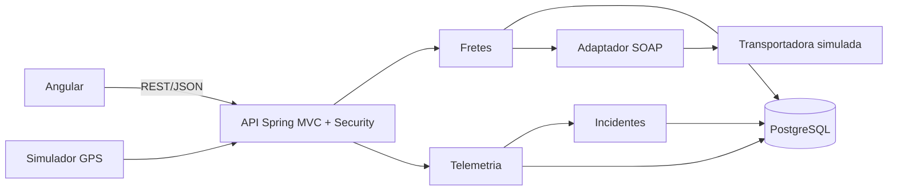

# LogiTrack

**Uma torre de controle B2B que transforma posições de veículos em decisões operacionais.**

O LogiTrack conecta o planejamento de fretes ao acompanhamento da entrega: o operador identifica atrasos, consulta a posição da frota e trata incidentes em um único painel Angular. Uma integração SOAP representa a transportadora legada, aproximando o projeto dos desafios de evolução e integração de sistemas corporativos.

> Status: T01 concluída — fundação executável com Spring Boot, PostgreSQL e Angular. As funcionalidades de fretes, autenticação, SOAP e rastreamento descritas abaixo continuam planejadas.

## Por que este projeto

Projeto de portfólio orientado à vaga de [Desenvolvedor(a) Java + Angular Sênior da Softtek](https://softtek.eightfold.ai/careers/job/893397755425), consultada em 20/10/2026. O objetivo é demonstrar decisões de engenharia, regras de negócio verificáveis e uma entrega pequena de ponta a ponta.

| Requisito da vaga | Evidência planejada no projeto |
| --- | --- |
| Java, orientação a objetos e separação de responsabilidades | Domínio de fretes, casos de uso e adaptadores de persistência e integração |
| Spring MVC e APIs REST/JSON | API validada, erros consistentes, paginação e contrato OpenAPI |
| Spring Security | Autenticação e autorização por perfil e por recurso |
| Angular e consumo de APIs | Dashboard, filtros, formulários e estados de carregamento e erro |
| Integrações SOAP/XML | Consulta de frete em transportadora simulada, com WSDL e tratamento de falhas |
| Análise e evolução de legado | Exemplo didático de regra antiga, testes de caracterização e refatoração documentada |
| Git e trabalho em equipe | Tarefas pequenas, branches, commits claros e PRs revisáveis |
| Entendimento de negócio e comunicação | Regras explícitas, critérios de aceite e roteiro de demonstração |
| Desenvolvimento assistido por IA com validação crítica | Registro de sugestões aceitas ou corrigidas e das verificações executadas |

O portfólio demonstra competências técnicas; não substitui experiência comprovada em produtos reais solicitada pela vaga.

## Demonstração prevista

1. O operador cadastra um frete com veículo, motorista, destino e prazo.
2. Consulta uma cotação na transportadora SOAP e registra o custo contratado.
3. Um simulador envia posições GPS e o painel acompanha o veículo.
4. Uma entrega que ultrapassa o prazo gera um incidente de atraso.
5. O operador reconhece o incidente; o motorista acessa apenas seus fretes e o diretor consulta indicadores.

## Escopo e arquitetura

A primeira entrega será um **monólito modular**, para concluir rapidamente o fluxo de negócio e manter limites claros entre fretes, telemetria, incidentes e integrações. A extração em microsserviços fica como evolução após o MVP.

Fundação implementada: Java 21, Spring Boot 4.1.1 com MVC, Actuator e JDBC, PostgreSQL 17.6, Flyway e Maven Wrapper 3.10.0; Angular 22.2.3 com TypeScript 6.0.2, Signals e RxJS; Docker Compose para execução local. Spring Security, Material e Leaflet serão adicionados nas respectivas tarefas.

O diagrama abaixo representa o escopo alvo do MVP. A decisão inicial está registrada no [ADR 0001](docs/adr/0001-monolito-modular.md).



Primeiro haverá atualização periódica no painel. WebSocket, RabbitMQ e Redis entram em tarefas posteriores, com testes de reconexão, duplicidade de eventos e indisponibilidade. RabbitMQ será o único broker inicial, evitando manter duas soluções de mensageria no projeto.

O MVP cobre transporte rodoviário com dados sintéticos. Otimização matemática de rotas, operação marítima, escala global e GPS real ficam fora da primeira entrega. Indicadores de custo serão comparação de valores contratados, sem promessa de otimização automática.

## Desenvolvimento por tarefas

O [plano de desenvolvimento](docs/PLANO.md) define a ordem, as entregas e os critérios de aceite. Cada tarefa deve terminar com uma mudança revisável e uma verificação reproduzível antes de iniciar a seguinte.

- [x] T00 — Escopo, alinhamento à vaga e documentação.
- [x] T01 — Fundação e ambiente local.
- [ ] T02–T07 — MVP: domínio, segurança, SOAP, Angular, acompanhamento e demonstração.
- [ ] T08–T10 — Evolução: streaming, mensageria, cache e extração de serviços.

## Repositórios e execução

- `logitrack-backend`: API, integração SOAP simulada, infraestrutura local e documentação de arquitetura.
- `logitrack-frontend`: aplicação Angular e experiência da torre de controle.

Pré-requisitos: JDK 21, Docker com Compose e, para o frontend, Node 24.22.0 com npm 11. O Maven é baixado pelo wrapper; não é preciso instalar Maven globalmente. Execute os comandos a partir deste diretório.

```sh
cp .env.example .env
docker compose up -d --wait
./mvnw spring-boot:run
```

O arquivo `.env` contém apenas credenciais fictícias locais e está ignorado no Git. Spring e Compose leem o mesmo arquivo. No macOS, se o Java padrão for outro, selecione o JDK 21 no terminal:

```sh
export JAVA_HOME=$(/usr/libexec/java_home -v 21)
```

Em outro terminal, confirme a saúde:

```sh
curl --fail http://localhost:8080/api/health
```

O retorno contém `"status":"UP"` e pode incluir os grupos de saúde habilitados. O endpoint verifica também a conexão ao banco, sem divulgar detalhes internos. Consulte o [contrato OpenAPI](docs/openapi.yaml).

Inicie o frontend no diretório irmão:

```sh
cd ../logitrack-frontend
nvm install
nvm use
npm ci
npm start
```

`nvm` é opcional se Node 24.22.0 já estiver selecionado. Abra [LogiTrack local](http://localhost:4200). A tela consulta a API pelo proxy de desenvolvimento e deve mostrar **Serviço disponível**.

Portas padrão: Angular `4200`, API `8080`, PostgreSQL `5433`. Se alterar a porta da API em `.env`, ajuste também o destino em `proxy.conf.json` do frontend. O proxy é exclusivo do servidor de desenvolvimento; um deploy futuro precisará encaminhar `/api` para o backend.

Para encerrar, use `Ctrl+C` nos terminais e `docker compose stop` para o banco. O volume preserva os dados. Alterar usuário, banco ou senha em `.env` não reconfigura automaticamente um volume PostgreSQL já inicializado.

## Verificação da fundação

```sh
./mvnw verify
```

Requer Docker ativo. Os dois testes iniciam PostgreSQL isolado via Testcontainers, verificam migração e schema, e consultam a saúde via HTTP. O banco local do Compose não é usado pelos testes.

No frontend, `npm run build` compila a aplicação e `npm run format:check` verifica a formatação. O [registro da T01](docs/T01-VALIDACAO.md) descreve os resultados observados e as limitações.

## Qualidade prevista

Testes de domínio para regras de atraso e transição de status; integração para persistência, autorização e SOAP; um fluxo ponta a ponta para a demonstração. A integração contínua executará build e verificações aplicáveis. Decisões e limitações serão registradas em ADRs; resultados de testes e medições só serão publicados após execução.
