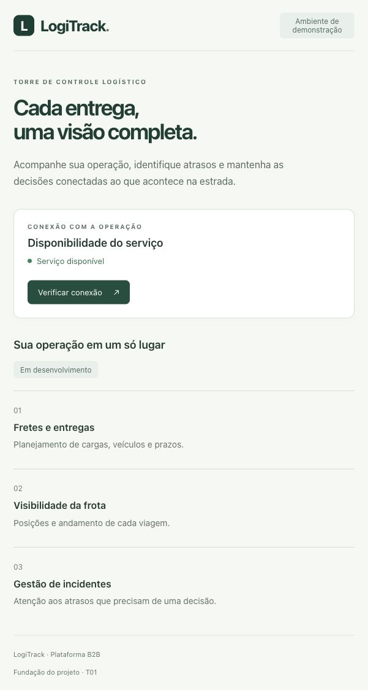

# T01 — Fundação e ambiente local

Concluída em 20/10/2026.

## Resultado

Backend Spring Boot 4.1.1 com alvo Java 21, Maven Wrapper 3.10.0, PostgreSQL
17.6 em Compose e migração Flyway V1. Frontend Angular 22.2.3 com dependências
diretas fixadas, lockfile, configuração estrita e tela inicial conectada à API.
Contrato HTTP em `openapi.yaml` e decisão de arquitetura no ADR 0001.

## Verificações executadas

| Verificação | Resultado |
| --- | --- |
| `./mvnw --batch-mode --no-transfer-progress verify`, com JDK 21.0.11 | Build aprovado; 2 testes, 0 falhas, 0 erros |
| PostgreSQL isolado via Testcontainers | Schema `logitrack` criado; migração V1 aplicada e validada; nenhuma migração pendente |
| Teste HTTP de `/api/health` | HTTP 200, status UP, sem componentes ou detalhes do banco |
| `docker compose up -d --wait` | PostgreSQL local saudável na porta 5433 |
| `./mvnw spring-boot:run` | API iniciada na porta 8080 e migração aplicada no banco local |
| `npm install` com Node 24.22.0 / npm 11.19.1 | Instalação e lockfile gerados; auditoria final reportou zero vulnerabilidades |
| `npm run build` | Build de produção aprovado |
| `npm run format:check` | Todos os arquivos verificados aprovados |
| `npm start` e navegador local | Tela renderizada; “Serviço disponível”; nova consulta pelo botão bem-sucedida |
| HTTP direto e pelo proxy Angular | `/api/health` retornou UP nas portas 8080 e 4200 |

## Validação crítica do trabalho assistido por IA

- A versão produzida pelo Initializr incluía o sufixo `RELEASE`; o POM foi
  normalizado para a versão publicada `4.1.1` e validado pelo build.
- A asserção inicial comparava o JSON inteiro com apenas `status`. O serviço
  também retorna grupos de saúde. O teste passou a validar o campo de status
  e a ausência de dados internos, e o contrato documenta os grupos opcionais.
- A instalação inicial usava Angular 22.2.0. A auditoria identificou um aviso
  no Router; todos os pacotes Angular foram alinhados em 22.2.3. A instalação
  limpa e o build passaram, e a auditoria final não reportou vulnerabilidades.
- O Node padrão da máquina era 25. A validação utilizou Node 24.22.0 em uma
  pasta temporária, sem alterar o Node global. `.nvmrc` e `engines` registram
  a versão suportada para reproduzir a execução.

## Limitações e próximos passos

A validação do frontend nesta etapa foi manual; não há suíte de testes de
negócio no Angular. Não foram implementados fretes, autenticação, SOAP, mapa,
mensageria ou cache. Não foi realizado teste de carga ou deploy.

Maven emitiu avisos de metadados de repositórios transitivos e de carregamento
dinâmico do agente Mockito; eles não impediram os testes nem o empacotamento.

Os diretórios ainda não têm Git ou remoto configurados. A próxima tarefa é
T02, domínio de fretes e API REST. A documentação de execução está nos READMEs
dos dois projetos.
